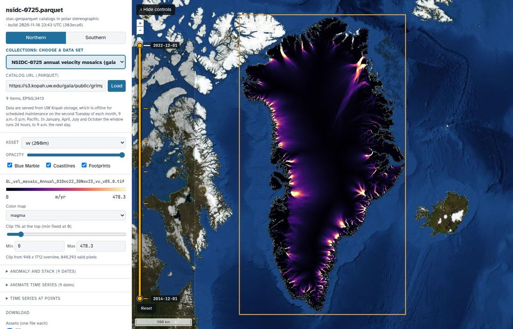
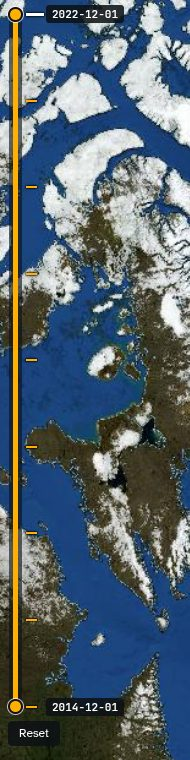
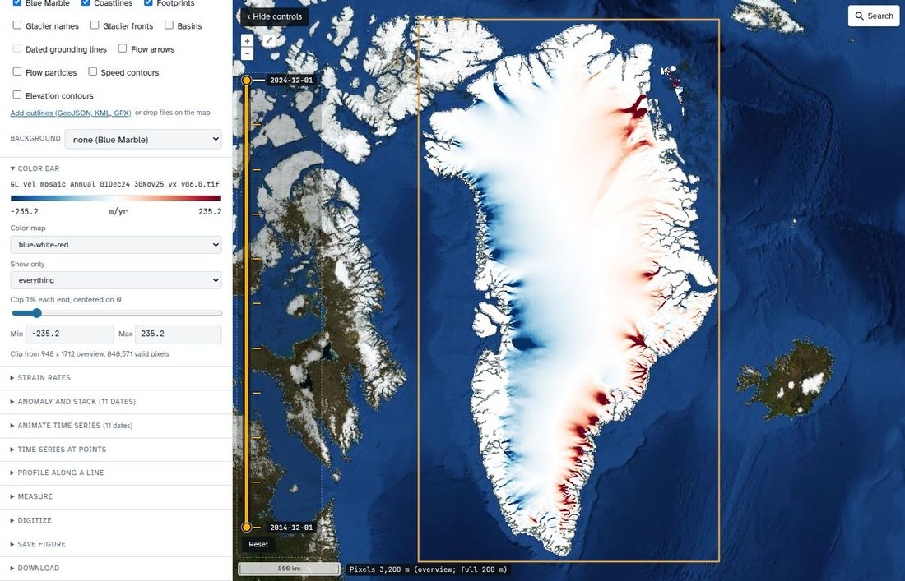
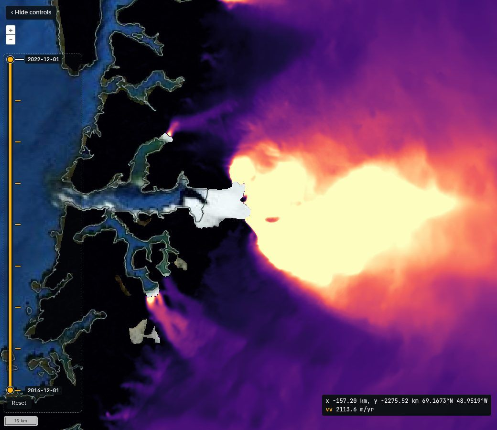
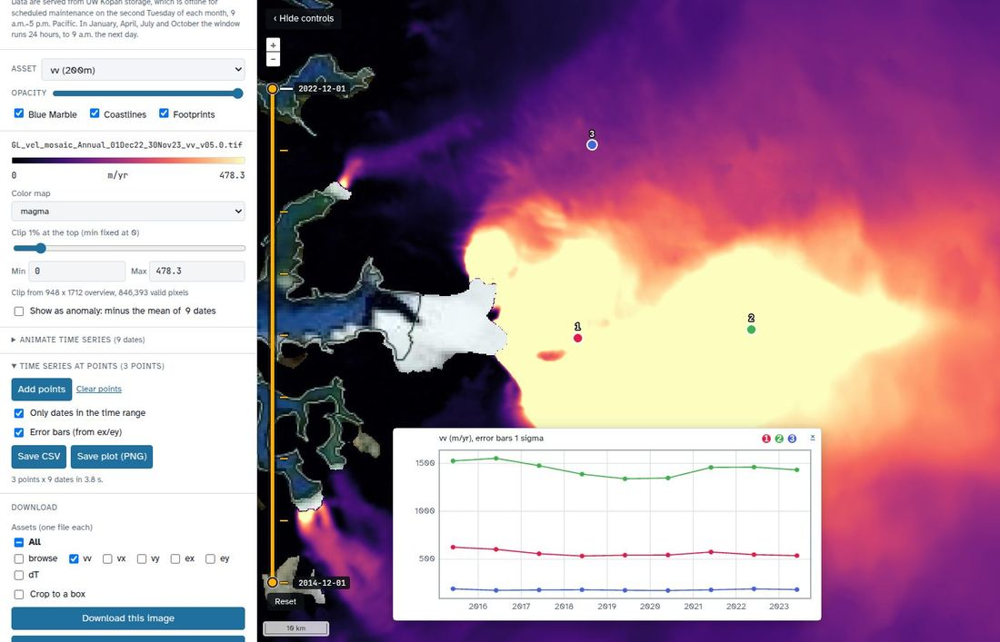
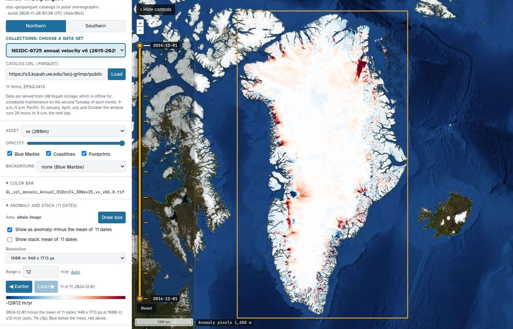
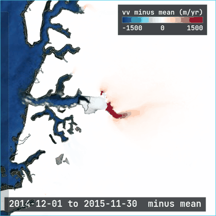
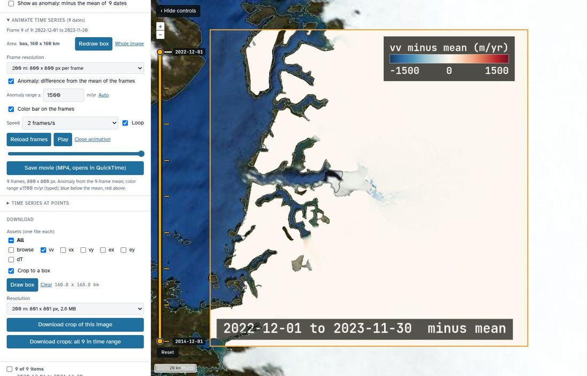
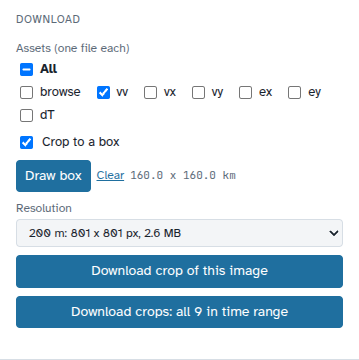
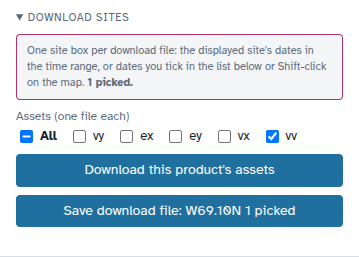

# GrIMP Polar Viewer

Browse, compare, animate and download Greenland and Antarctic ice-sheet products from
[GrIMP](https://nsidc.org/grimp) and NISAR in your web browser, on maps drawn the way polar
scientists draw them: centered on the pole, in polar stereographic coordinates.



## Open the viewer

| Start with | Link |
|---|---|
| Greenland annual ice velocity (NSIDC-0725) | [open](https://s3.kopah.uw.edu/ianj-grimp/public/viewer/index.html?href=https://s3.kopah.uw.edu/gaia/public/grimp/nsidc-0725/v05/nsidc-0725.parquet&asset=vv) |
| Greenland radar backscatter, 2024 | [open](https://s3.kopah.uw.edu/ianj-grimp/public/viewer/index.html?href=https://s3.kopah.uw.edu/ianj-grimp/public/nsidc-0723/v04/nsidc-0723.parquet) |
| Greenland glacier sites from TerraSAR-X (NSIDC-0481) | [open](https://s3.kopah.uw.edu/ianj-grimp/public/viewer/index.html?href=https://s3.kopah.uw.edu/gaia/public/grimp/nsidc-0481/v04/nsidc-0481.parquet) |
| Antarctica, NISAR 25 m radar mosaic | [open](https://s3.kopah.uw.edu/ianj-grimp/public/viewer/index.html?href=https://s3.kopah.uw.edu/ianj-grimp/public/display/nisar-gcov-ant-25m.parquet) |

Nothing to install: it runs in any current desktop browser (Chrome, Edge, Firefox, Safari).
Hover over any control for a short explanation.

## A quick tour

### 1. Pick what to look at


Choose **Northern** or **Southern**, then a collection from the **Collections** menu. The newest
product opens on the map. Every product in the collection is listed at the bottom of the panel
and outlined on the map; click either to show it.

Anyone can open their own data by pasting a catalog link into **Catalog URL** (see
[Using your own data](#using-your-own-data)).

<br clear="right">

### 2. Move through time



The bar down the left edge of the map is a timeline, newest at the top, with a tick for each date.

- **Drag the two handles** to choose the range of dates you are interested in.
- **Click a tick** to show the product from that date.
- **Reset** brings back every date.

<br clear="right">

### 3. Adjust the colors and read off values


Pick a **color map**, and use the **Clip** slider to set how many of the brightest (and darkest)
pixels saturate, or type exact **Min** and **Max** values. Speeds start at zero; velocity
components (vx, vy) are centered on zero in blue and red:

<br clear="right">



Point at the map to read the exact value under the pointer, with its position in kilometers and
in latitude and longitude:



### 4. Plot a time series at points

Open **Time series at points**, click **Add points**, and click the spots on the map you want to
follow. Each point is read at full resolution from every date and plotted against time, one color
per point, with error bars for velocity. **Save CSV** writes the numbers (date, position, value,
error) for a spreadsheet or script; **Save plot** writes the picture.



### 5. See what changed

When a product is part of a time series, tick **Show as anomaly** to see how one date differs
from the average of all dates: blue where the ice was slower than usual, red where it was faster.
Step through the years with **Earlier** and **Later**, or by clicking the ticks on the timeline.



### 6. Make an animation

Open **Animate time series**, draw a box around the area you want (or animate the whole image),
and click **Load frames**. Then **Play**, change the speed, or drag the slider through the frames.
Tick **Anomaly** to animate the change from the mean, and **Color bar** to label the frames.
**Save movie** writes an MP4 that plays in QuickTime, Windows Media Player, PowerPoint and
web browsers.



Here is Jakobshavn Isbræ from 2014 to 2023, as each year's speed minus the nine-year mean, with
the range set to ±1500 m/yr: faster than average (red) in 2014-2016, slower (blue) in
2017-2019, and faster again in 2020-21.

<br clear="right">



### 7. Download data



Tick the files you want under **Assets** (for velocity: speed, components, errors and more), then:

- **Download this image** saves the original files of the product on the map.
- **Download selection** covers every product in the time range, or just the ones you have
  picked. For many large files it saves a list of links to fetch with `wget`.
- **Crop to a box** cuts out just the area you draw, at the resolution you choose, as GeoTIFFs
  ready for GIS software.

<br clear="right">



Small glacier-site products, such as the TerraSAR-X boxes, are downloaded whole: tick
**Select all sites**, tick sites in the list, or **Shift-click** a box on the map.

<br clear="right">


### 8. Antarctica

Switch to **Southern** for Antarctic products, drawn with the South Pole at the center:


## Good to know

- **Sharing a view:** the address bar holds the collection you are looking at, so you can
  bookmark or share it. The browser's Back button returns to the previous collection.
- **Maintenance:** the data are stored on UW's Kopah storage, which is offline for maintenance on
  the second Tuesday of each month, 9 a.m.-5 p.m. Pacific (24 hours in January, April, July and
  October). The viewer will not load during those windows.
- **Hide controls** (top left of the map) gives the map the whole window.
- **Phones and tablets:** the controls sit below the map; hide them for a full-screen map. Tap the
  map to read a value.
- **Resolution of anomalies and animations:** whole ice sheets are shown at a coarser level; draw a
  box to work at full resolution.

## Using your own data

Any public collection of cloud-optimized GeoTIFFs with a stac-geoparquet catalog can be opened in
the viewer, in Greenland (EPSG:3413) or Antarctic (EPSG:3031) polar stereographic. Put the catalog
link after `?href=`:

```
https://s3.kopah.uw.edu/ianj-grimp/public/viewer/index.html?href=<your catalog URL>
```

[Documents/grimpPolarViewer.md](Documents/grimpPolarViewer.md) describes the catalog format, how
to make one, how to host the files, and how the viewer works.

## For maintainers

Publishing new data, deploying the viewer, the repository layout and the design are covered in
[Documents/grimpPolarViewer.md](Documents/grimpPolarViewer.md).
