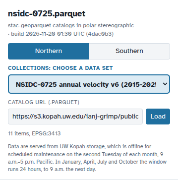
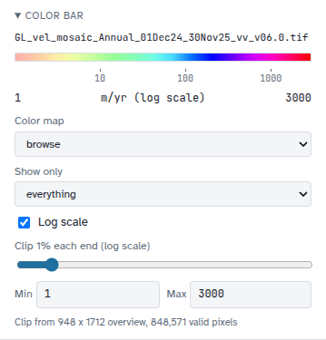
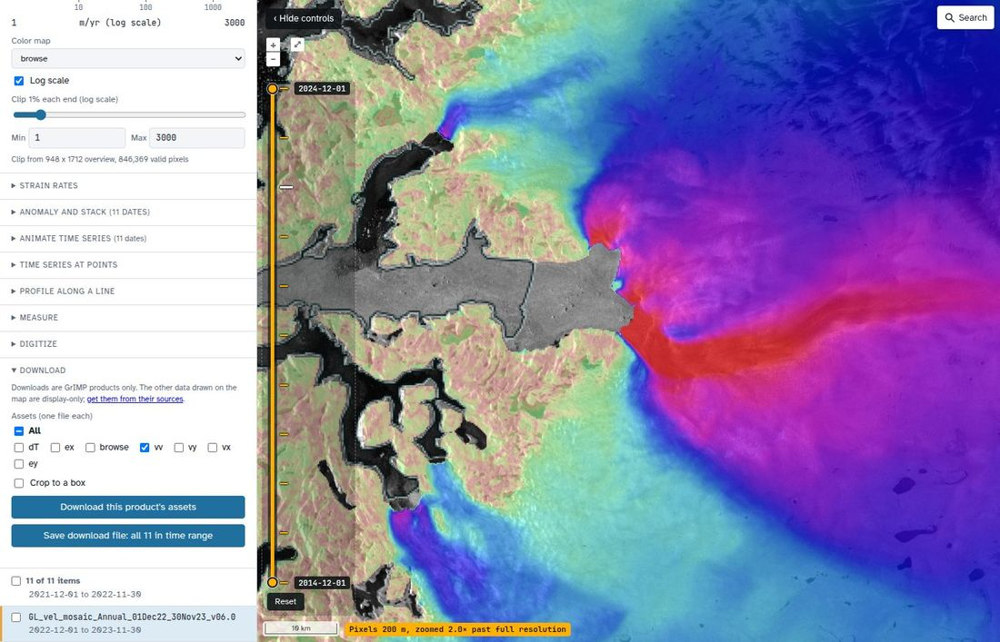
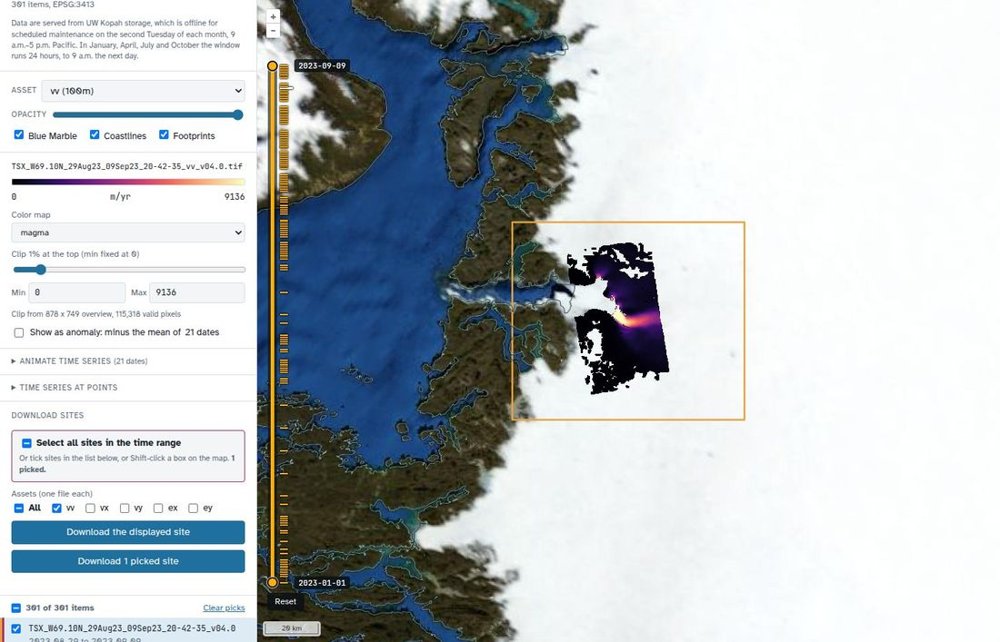
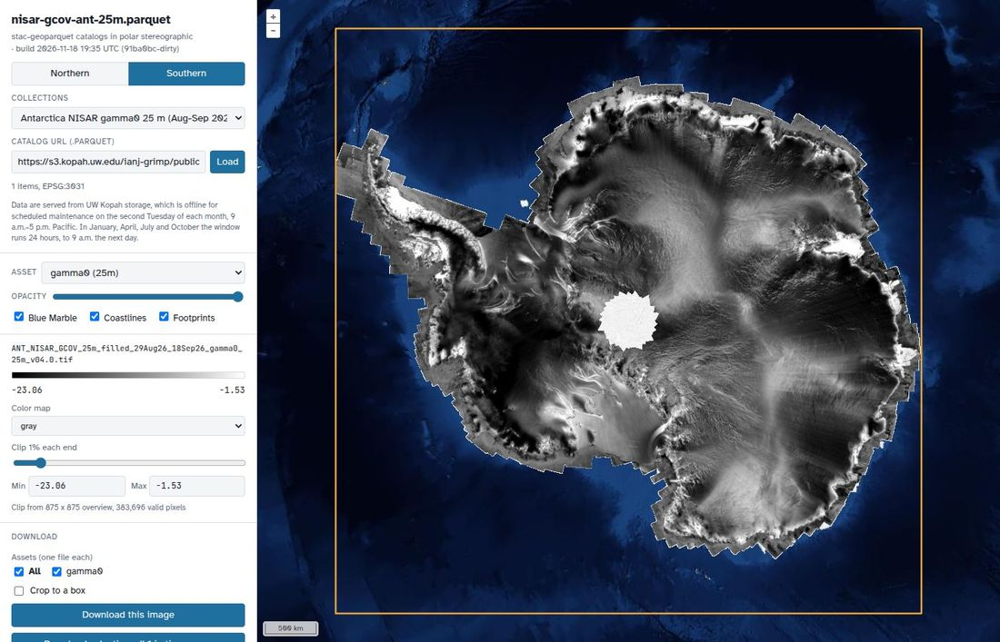

# GrIMP Polar Viewer

Browse, compare, animate and download Greenland and Antarctic ice-sheet products from
[GrIMP](https://nsidc.org/grimp) and NISAR in your web browser, on maps drawn the way polar
scientists draw them: centered on the pole, in polar stereographic coordinates.

Created by Ian Joughin and Scott Henderson ([@scottyhq](https://github.com/scottyhq)).

**▶ [Watch the video tutorial](https://s3.kopah.uw.edu/ianj-grimp/public/viewer/tutorial/index.html)** (5½ minutes, narrated, with captions): collections, colors, time-series and
profile plots, flow lines, map layers, animation, swipe, sharing and download, in Greenland and at
Pine Island Glacier.

> **Downloads are GrIMP products only.** The other data drawn in the viewer (glacier fronts and
> names, basins, grounding lines, place names, ITS_LIVE velocities and the basemap) are for display
> only. Download them from their own distributors, linked under
> [Other data shown in the viewer](#other-data-shown-in-the-viewer) at the end of this page.


## Open the viewer

| Start with | Link | NSIDC data set |
|---|---|---|
| Greenland annual ice velocity, 2015-2025 (NSIDC-0725 v6) | [open](https://s3.kopah.uw.edu/ianj-grimp/public/viewer/index.html?href=https://s3.kopah.uw.edu/ianj-grimp/public/nsidc-0725/v06/nsidc-0725.parquet&asset=vv) | [NSIDC-0725 v5](https://doi.org/10.5067/USBL3Z8KF9C3) |
| Greenland monthly ice velocity, 2015-2026 (NSIDC-0731 v6) | [open](https://s3.kopah.uw.edu/ianj-grimp/public/viewer/index.html?href=https://s3.kopah.uw.edu/ianj-grimp/public/nsidc-0731/v06/nsidc-0731.parquet&asset=vv) | [NSIDC-0731 v5](https://doi.org/10.5067/EGKZX6FXXM4P) |
| Greenland quarterly ice velocity, 2015-2026 (NSIDC-0727 v6) | [open](https://s3.kopah.uw.edu/ianj-grimp/public/viewer/index.html?href=https://s3.kopah.uw.edu/ianj-grimp/public/nsidc-0727/v06/nsidc-0727.parquet&asset=vv) | [NSIDC-0727 v5](https://doi.org/10.5067/V5KW64S63OSN) |
| Greenland radar backscatter, 2020-2026 | [open](https://s3.kopah.uw.edu/ianj-grimp/public/viewer/index.html?href=https://s3.kopah.uw.edu/ianj-grimp/public/nsidc-0723/v04/nsidc-0723.parquet) | [NSIDC-0723 v4](https://doi.org/10.5067/WXQ366CP8YDE) |
| Greenland 6/12-day ice velocity, 2015-2026 (NSIDC-0766 v3) | [open](https://s3.kopah.uw.edu/ianj-grimp/public/viewer/index.html?href=https://s3.kopah.uw.edu/ianj-grimp/public/nsidc-0766/v03/nsidc-0766.parquet&asset=vv) | [NSIDC-0766 v2](https://doi.org/10.5067/1AMEDB6VJ1NZ) |
| Greenland glacier sites from TerraSAR-X, 2008-2026 (NSIDC-0481 v5) | [open](https://s3.kopah.uw.edu/ianj-grimp/public/viewer/index.html?href=https://s3.kopah.uw.edu/ianj-grimp/public/nsidc-0481/v05/nsidc-0481.parquet&asset=vv) | [NSIDC-0481 v4](https://doi.org/10.5067/GQZQY2M5507Z) |
| Amundsen Sea (Pine Island, Thwaites) quarterly ice velocity, 2015-2026 | [open](https://s3.kopah.uw.edu/ianj-grimp/public/viewer/index.html?href=https://s3.kopah.uw.edu/ianj-grimp/public/pig/quarterly/ase-quarterly.parquet&asset=vv) | |
| Amundsen Sea (Pine Island, Thwaites) radar backscatter, 2015 to Feb 2026 | [open](https://s3.kopah.uw.edu/ianj-grimp/public/viewer/index.html?href=https://s3.kopah.uw.edu/ianj-grimp/public/pig/backscatter/v04/ase-backscatter.parquet) | |
| Amundsen Sea (Pine Island, Thwaites) annual ice velocity, 2015-2026 | [open](https://s3.kopah.uw.edu/ianj-grimp/public/viewer/index.html?href=https://s3.kopah.uw.edu/ianj-grimp/public/pig/annual/ase-annual.parquet&asset=vv) | |
| Antarctica, NISAR 25 m radar mosaic | [open](https://s3.kopah.uw.edu/ianj-grimp/public/viewer/index.html?href=https://s3.kopah.uw.edu/ianj-grimp/public/display/nisar-gcov-ant-25m.parquet) | |

The NSIDC column links to each product's DOI landing page at NSIDC. The viewer's copies may be one
version ahead of NSIDC (annual, quarterly and monthly v6, 6/12-day v3 and TerraSAR-X v5, while
NSIDC holds v5, v5, v5, v2 and v4), so the DOI and reference are for the latest version released
at NSIDC. To cite the data, use NSIDC's references:

- Joughin, I. (2023). MEaSUREs Greenland Annual Ice Sheet Velocity Mosaics from SAR and Landsat.
  (NSIDC-0725, Version 5). [Data Set]. Boulder, Colorado USA. NASA National Snow and Ice Data
  Center Distributed Active Archive Center. https://doi.org/10.5067/USBL3Z8KF9C3.
- Joughin, I. (2023). MEaSUREs Greenland Monthly Ice Sheet Velocity Mosaics from SAR and Landsat.
  (NSIDC-0731, Version 5). [Data Set]. Boulder, Colorado USA. NASA National Snow and Ice Data
  Center Distributed Active Archive Center. https://doi.org/10.5067/EGKZX6FXXM4P.
- Joughin, I. (2023). MEaSUREs Greenland Quarterly Ice Sheet Velocity Mosaics from SAR and Landsat.
  (NSIDC-0727, Version 5). [Data Set]. Boulder, Colorado USA. NASA National Snow and Ice Data
  Center Distributed Active Archive Center. https://doi.org/10.5067/V5KW64S63OSN.
- Joughin, I. (2021). MEaSUREs Greenland Image Mosaics from Sentinel-1A and -1B. (NSIDC-0723,
  Version 4). [Data Set]. Boulder, Colorado USA. NASA National Snow and Ice Data Center Distributed
  Active Archive Center. https://doi.org/10.5067/WXQ366CP8YDE.
- Joughin, I. (2022). MEaSUREs Greenland 6 and 12 day Ice Sheet Velocity Mosaics from SAR.
  (NSIDC-0766, Version 2). [Data Set]. Boulder, Colorado USA. NASA National Snow and Ice Data
  Center Distributed Active Archive Center. https://doi.org/10.5067/1AMEDB6VJ1NZ.
- Joughin, I., Howat, I., Smith, B. & Scambos, T. (2021). MEaSUREs Greenland Ice Velocity: Selected
  Glacier Site Velocity Maps from InSAR. (NSIDC-0481, Version 4). [Data Set]. Boulder, Colorado
  USA. NASA National Snow and Ice Data Center Distributed Active Archive Center.
  https://doi.org/10.5067/GQZQY2M5507Z.

These links only choose where to start. Once the viewer is open, switch to any other data set with
the **Collections** menu at the top of the panel, and between Greenland and Antarctica with the
**Northern** / **Southern** buttons above it.

To send someone what you are looking at, click **Share this view** under the catalog URL. It copies
a link (and puts it in the address bar) that reopens the same collection, product, asset, map position
and zoom, time range, color map and range, opacity, layers (glacier names, fronts and their years, basins,
dated grounding lines and their years, flow arrows, particles, speed contours and their levels), background
image, time-series points and their trend, and the profile or flow line with its travel-time marks, date
series and reference date.
**Share this animation**, in the Animate section, does the same and adds the animation's area box and
settings; whoever opens the link clicks **Load frames** to build it.
The **QR code** link next to either button shows the same link as a QR code, to scan with a phone or
save as an image for a slide or poster. **Embed** copies HTML for an iframe of the view to put in a web
page or slide: it shows the map alone (no panel), with an **Open in the full viewer** link.

Nothing to install: it runs in any current desktop browser (Chrome, Edge, Firefox, Safari). Only
downloading many files at once uses a small command-line tool (see [Download data](#8-download-data)).
Hover over any control for a short explanation.

## A quick tour

### 1. Pick what to look at



Choose **Northern** or **Southern**, then a collection from the **Collections** menu (the
highlighted box near the top of the panel; it lists every data set for that hemisphere). The newest
product opens on the map, at the same zoom and place if you switch collections within a hemisphere,
so you can compare data sets at one glacier (the **⤢** button beside **+** and **−** zooms back out
to the whole collection). Every product in the collection is outlined on the map, and listed
under **Download** when that section is open; click either to show it.

For a quick start, **Go to a glacier** (under the Collections menu) zooms to a well-known glacier or
region of the hemisphere: Jakobshavn, Helheim, Kangerlussuaq, Petermann or 79 North in Greenland; Pine
Island, Thwaites, Totten or the big ice shelves in Antarctica.

To find any other glacier, click **Search** at the top right of the map, type its name and pick it from the
list (or press Enter for the first); the box folds back to the button (click it again, or press
Escape, to close it yourself). Old and foreign names work too: *Jakobshavn* finds
Sermeq Kujalleq, and accents are optional (*isbrae* finds Isbræ). In Antarctica it searches glaciers, ice
shelves, bays, stations, ranges and other large features from the SCAR Composite Gazetteer.

Anyone can open their own data by pasting a catalog link into **Catalog URL** (see
[Using your own data](#using-your-own-data)).

<br clear="right">

### 2. Move through time


The bar down the left edge of the map is a timeline, newest at the top, with a tick for each date.

- **Drag the two handles** to choose the range of dates you are interested in.
- **Click a tick** to show the product from that date.
- **Reset** brings back every date.

<br clear="right">

### 3. Adjust the colors and read off values



In the **Color bar** section, pick a **color map**, and use the **Clip** slider to set how many of the
brightest (and darkest) pixels saturate, or type exact **Min** and **Max** values. Speeds start at zero
(in viridis until you pick another map); velocity components (vx, vy) are centered on zero in blue and
red:

<br clear="right">


Point at the map to read the exact value under the pointer, with its position in kilometers and
in latitude and longitude:


Tick **Flow arrows** on a velocity product to see which way the ice moves: each arrow shows the flow
averaged over its patch of the screen, and longer arrows are faster. They are redrawn as you pan and
zoom, and left out where ice moves slower than 5 m/yr (and on rock). Tick **Flow particles** for streaks
that drift with the flow instead: faster ice moves faster and leaves longer trails (they pause while the
map moves). **Save particle movie** saves 10 seconds of them over a still of the map as shown, as an MP4
at screen resolution that loops seamlessly when played on repeat. Tick **Speed contours** for lines of equal speed, labeled in m/yr; type the speeds you want
in the box under the toggles.

When you point at a velocity product that has error layers, the readout gives the value with its
1-sigma error (for example *vv 5595.4 ± 12.1 m/yr*).

In Antarctica, **Coastlines** draws the grounding line (white) and the ice front and coast of the GrIMP
2026 ice mask (cyan, with ice shelf names as you zoom in); click either entry in its legend to hide or show
that line. Tick **Basins** for the drainage basins (dashed yellow): IMBIE in Antarctica, with their labels,
and the glacier basins of Mouginot and Rignot (2019) in Greenland (tick **Glacier names** to label them).
Point at a basin for its true area in km², corrected for the polar stereographic map's scale distortion
(the map area is shown beside it).
Tick **Dated grounding lines** for the InSAR grounding lines of the Amundsen Sea glaciers (Pine Island,
Thwaites, Pope, Smith, Kohler, Getz, Abbot and others) from 1992 to 2025, colored from blue (oldest) to red
(newest); point at one for its date and sensor, and drag the handles on its color bar to pick the years
drawn (the band between them slides the range).

Reference layers from other sources (glacier names and fronts, boundaries, ITS_LIVE) are for display
and comparison only; the downloads and saved files contain GrIMP data only.

To see your own field sites, tracks or outlines on the map, drop GeoJSON, KML or GPX files on it (or use
**Add outlines**). They stay in your browser: nothing is uploaded, and the list under the boxes has
**Zoom** and **×** for each file.

Tick **Glacier fronts** (Greenland only) to draw the winter ice-front positions of up to 239 outlet
glaciers from 1972-73 to 2020-21, colored from blue (oldest) to red (newest), so a retreat reads as a
sweep of color up the fjord. Point at a front to see its date in the readout. Drag the two handles on the
color bar to draw only the winters between them, or drag the outlined band between the handles to slide
that range along, keeping its length.

Tick **Glacier names** to label the glaciers: in Greenland with their official names, followed by a
different foreign name in parentheses, e.g. *Sermeq Kujalleq (Jakobshavn Isbræ)*; in Antarctica with
the SCAR gazetteer names of glaciers, ice streams, ice shelves, stations and regions. Zoomed all the way out
only the major glaciers are named; zoom in for every outlet glacier, then local glaciers and ice caps.
Labels sit on the ocean side of each glacier. Names come from the official
Greenland glacier names set (Bjørk et al. 2015), plus 79 North Glacier (Nioghalvfjerdsbræ), which that
set does not include.

To see the ice and rock under the data, choose a radar image in **Background** (below the Blue Marble
and Coastlines boxes), pick one of its dates under **Image**, and lower **Opacity**. The choice is kept
for each hemisphere while the browser tab is open:



### 4. Plot a time series at points

Open **Time series at points**, click **Add points**, and click the spots on the map you want to
follow, or **Load points** from a CSV file of sites (lat/lon or x/y, with optional names). Each
point is read at full resolution from every date and plotted against time as the values arrive, one
color per point. With a velocity **browse** image on the map, points (and profile lines) read the
speed (vv), so the browse image can serve as the map to pick on. Tick **Error bars** for velocity errors; it is slower, since a speed error needs four
more files per date.

- The plot and the timeline are linked: the date on the map is marked on the plot, and clicking a
  point on the plot shows that date's image.
- Drag the **✥** at the plot's top left to move it anywhere over the map, and its bottom-right
  corner to resize it; double-click the ✥ to put it back.
- **Plot y range** sets the y axis: drag either handle, or drag the band between them to move the
  range up or down. The x axis follows the timeline's range. **Plot style** draws
  lines and points, points only, or lines only.
- Tick **Trend** to fit each point's values on the plot's x axis by least squares, as a **straight line**
  or a **line + annual cycle** (a sinusoid with a one-year period). It is drawn dashed in the point's
  color, and a box lists each point's rate per year with the 1-sigma error of that rate, r² and p
  (two-sided t test of a zero rate); with the cycle, also its amplitude (±, half the peak-to-trough
  range) and the date of its peak. For monthly and shorter products, use the cycle: the seasonal
  speed-up otherwise inflates the scatter about the line and biases the rate's error and p. With
  **Error bars** on, the fit is weighted by 1/error² (the box says so). Drag the box to move it; click its
  header to shrink it to **Trend +** and click that to bring it back. A line needs at least three dates,
  a cycle five spread through the year (annual products all fall at one time of year, so they have none).
  It fits only the collection shown, and is off in the month-of-year view. **Save CSV** adds each
  point's fit as extra columns. p assumes the scatter about the fit is independent from date to date.
- **Plot x axis: month of year** folds the series onto January to December, with one line per year
  colored from blue (oldest) to red (newest), to compare the seasonal cycle from year to year. A thick
  black line (white in dark mode) joins each point's mean for every calendar month. Click a value to show
  that product: its year is then drawn on top, thicker and labeled, with the other years faded.
- In the TerraSAR-X collection, each point reads the site boxes that contain it, so points can be at
  different glaciers; adding a point outside the orange box switches the map to that point's site.
- Tick **ITS_LIVE in grey** to compare with the ITS_LIVE image-pair velocities at the same points.
- Switch to another velocity collection and your points stay: its values are drawn on top, with the
  previous collection's series underneath for comparison.
- The numbered dots at the plot's top right are its legend: click a number to hide or show that
  point's series (the number and its map marker fade while hidden), or the **×** beside it to
  remove the point from the map and the plot. When the plot also holds an earlier collection, its
  second legend row names each collection: click one to hide or show its series at every point, or
  the **×** beside an earlier collection to drop its series.
- **Save CSV** writes the numbers (date, position, value, error, collection) for a spreadsheet or
  script, leaving out hidden points; **Save plot** writes the picture.


### 5. Plot a profile along a line

Open **Profile along a line**, click **Draw line**, and click the start (A) and the end (B) on the
map. The product on the map is read along the line and plotted against distance from A.

Or click **Flow line** and click a point on a glacier: a line is traced along the ice flow, upstream
and downstream of the point. Drag the white point to nudge the line until it follows the glacier the
way you want (it is traced again as you drag), then click **Use this line** to plot it. To place the
point exactly, type it in the **Point** box instead and press Enter or **Trace**: lat, lon (*69.17, -49.5*
or *69.17N 49.5W*) or x, y in km (*-180, -2273 km*). **Adjust
point** lets you move it again later. The two handles on the slider set how far the line runs
upstream (left) and downstream (right) of the point, up to 150 km each way, and the plot gives
distance downstream of the point (negative upstream). The flow comes from the newest annual
velocity mosaic (Greenland, or the Amundsen Sea in Antarctica), whatever product is shown, or, where
there is none, from the loaded catalog's velocity product with the longest averaging period.
Tick **Travel-time marks** to dot the flow line every 1, 2, 5 ... 100 years: where ice at the point will
be after that many years (+, downstream) and where it was that long ago (-, upstream), for steady flow at
the mosaic's speeds. The plot marks them with ticks along its bottom.

- Show another date (a timeline tick, a footprint on the map, or a point on the time-series plot) and
  its curve is added to the same plot, so you can see a front retreat or a speed-up along the flow
  line. Switching to another collection keeps the line and adds that collection's curve. The product
  on the map is drawn thickest and in bold in the legend. Click an entry in the legend to hide its
  curve (the entry fades), and click it again to show it; click the **×** at the end of an entry to
  remove that curve (show its date again to bring it back). Drag the legend to move it off the data,
  or click its top row (**Legend −**) to shrink it to a small **Legend +** box, and click that to
  bring it back. A shrunk legend is left out of the saved PNG.
- Tick **Dates every** to add curves at regular steps from the product on the map: choose the step
  (6 days to 5 years; steps shorter than the product are not offered), and each step adds the
  product of the same length nearest that date. For example, with the 2019 annual mosaic shown and
  a 2-year step, it adds 2021, 2023 and 2025; a 1-year step on a monthly mosaic plots the same month of
  each year. It starts with the shown date and up to three later ones. **◀** and **▶** add one
  date at either end; once 8 are plotted (the limit) they slide the series instead. On the slider
  under them, drag a handle to add or drop dates at that end, or drag the band to slide the whole
  series through time. Changing the step, or ticking the box again, starts over from the product
  on the map; curves you added by showing dates yourself stay.
- With two or more curves, **Plot** switches from the values to the **change from** any one curve's
  date: each curve minus that one, interpolated to the same distances along the line (the reference
  plots as zero, dotted). It shows where along the glacier the speed has changed since then. ITS_LIVE
  is left out, and **Save CSV** adds a column of the change.
- **Plot x range** and **Plot y range** zoom the plot: drag either handle, or drag the band between
  them to pan; **Auto** goes back to the full line and the automatic y range. With x zoomed in, the
  automatic y range fits the part of the line shown.
- Choosing another asset (for example vx instead of speed), or drawing a new line, starts a new plot.
- Tick **ITS_LIVE in grey** to add the ITS_LIVE image pairs whose time span includes the middle date
  of the product on the map, one grey line per pair, sampled every 120 m. **Pairs up to** limits
  how far apart the two images are. The ITS_LIVE datacubes currently end in May 2025. For an annual
  product, the ITS_LIVE annual mosaic of the calendar year holding its middle date is drawn instead,
  as one dashed grey line (ITS_LIVE annual mosaics currently end with 2022).
- With **Glacier fronts** (Greenland) or **Dated grounding lines** (Amundsen Sea) on, **Fronts along the
  line** plots where each front or grounding line drawn crosses the line, as distance along the line
  against date, so a retreat reads as a falling trend; the year sliders on their color bars pick the
  years. The profile plot ticks the same crossings along its top, in the year colors. A flow line ends at
  the newest front (where the mosaic ends), so draw a line down the fjord for the older fronts.
- The plot moves and resizes like the time-series plot. **Save CSV** writes the GrIMP curves shown,
  one row per sample (ITS_LIVE is drawn for comparison only and is not saved); **Save plot** writes the picture.

### 6. See what changed

When a product is part of a time series, open **Anomaly and stack** and tick **Show as anomaly** to see how one date differs
from the average of all dates: blue where the ice was slower than usual, red where it was faster.
Step through the years with **Earlier** and **Later**, or by clicking the ticks on the timeline.
**Show stack** instead averages every date in the time range into one image. Both cover the whole
image, or a box you draw with **Draw box** in that section for full resolution.

To compare two dates directly, pick one under **Minus**: the anomaly then shows the displayed date
minus that date, e.g. 2024-25 minus 2014-15. Set **As** to **percent change** to show it relative to
that date (or the mean) instead, which compares slow and fast ice on one scale; pixels where the
reference is near zero (under 1% of its 99th-percentile value) are left blank. Or tick **Swipe: compare with another date** to split
the map: the date you pick shows left of a line and the displayed date right of it, in the same
colors. Drag the round handle (or use the arrow keys) to slide the line across a glacier.


### 7. Make an animation

Open **Animate time series**, draw a box around the area you want (the same box as the anomaly and
stack, or animate the whole image),
and click **Load frames**. Then **Play**, change the speed, or drag the slider through the frames.
Tick **Anomaly** to animate the change from the mean, and **Color bar** to label the frames. For
long series, set **At least N days between frames** to skip dates; fewer frames allow a sharper
animation.
**Save movie** writes an MP4 that plays in QuickTime, Windows Media Player, PowerPoint and
web browsers.


Here is Jakobshavn Isbræ from 2014-15 to 2024-25, as each year's speed minus the 11-year mean,
with the range set to ±1500 m/yr: faster than average (red) in 2014-16, slower (blue) in 2016-19,
faster again in 2020-21, and close to or a little below average since.

<br clear="right">


### 8. Download data


Only GrIMP products download; for the other data drawn in the viewer, see
[Other data shown in the viewer](#other-data-shown-in-the-viewer).
Tick the files you want under **Assets** (for velocity: speed, components, errors and more), then:

- **Download this product's assets** saves the ticked assets of the product on the map (one file each), from NSIDC when NSIDC
  holds that version (the browser first shows the Earthdata login, then the file downloads) and from
  the viewer's copy otherwise. With **Crop to a box** it saves just the area you draw, at the resolution
  you choose (for a product at NSIDC it saves a download file for `grimpdownload` instead).
- **Save download file** covers every product in the time range, or just the ones you have picked,
  whole or cropped to your box. It saves a small `.grimp.yaml` file; download the data with the
  `grimpdownload` command (install once with `pip install git+https://github.com/fastice/grimpPolarViewer`):

  ```
  grimpdownload nsidc-0725-v6_2026-11-20.grimp.yaml --outDir jakobshavn
  ```

  Each file comes from NSIDC when NSIDC holds that version (the archived copy the DOI refers to; NSIDC
  asks once for a free [Earthdata login](https://urs.earthdata.nasa.gov/users/new)), otherwise from the
  viewer's copy. See [Documents/grimpDownload.md](Documents/grimpDownload.md).

<br clear="right">


Small glacier-site products, such as the TerraSAR-X boxes, are downloaded whole, one site box per
download file: the dates of the displayed site in the time range, or dates you pick from one site
(tick them in the list, or **Shift-click** a box on the map).

<br clear="right">



### 9. Antarctica

Switch to **Southern** for Antarctic products, drawn with the South Pole at the center:



## Good to know

- **Sharing a view:** the address bar holds the collection you are looking at, so you can
  bookmark or share it. The browser's Back button returns to the previous collection.
- **Maintenance:** the data are stored on UW's Kopah storage, which is offline for maintenance on
  the second Tuesday of each month, 9 a.m.-5 p.m. Pacific (24 hours in January, April, July and
  October). The viewer will not load during those windows.
- **Hide controls** (top left of the map) gives the map the whole window.
- **Measure** (in the panel): **Distance** draws a line (click points, double-click to finish) and
  **Area** a polygon (click the corners, then the first one again or double-click). Each is labeled on
  the map with its true length or area on the WGS84 ellipsoid; the panel also gives the polar
  stereographic map's own value, which differs by the projection's scale. **Clear** removes them.
- **Phones and tablets:** the controls sit below the map; hide them for a full-screen map. Tap the
  map to read a value.
- **Pixel size:** the label beside the scale bar gives the size of the pixels on the map: a coarser
  overview when zoomed out, then the product's full resolution as you zoom in (and the grid of an
  anomaly, stack or animation while one is shown). It turns amber once you have zoomed in past full
  resolution, where further zooming only enlarges the pixels.
- **Resolution of anomalies, stacks and animations:** whole ice sheets are shown at a coarser
  level; draw a box to work at full resolution.
- **Long point extractions take time:** each point reads one file per date, or five for speed with
  **Error bars** ticked (one point over the 516 six-day windows with error bars, 2,580 files, takes
  about a minute). Narrow the time range for many points.
- **Points can't be placed under the timeline** (its faint box takes the clicks); pan the map instead.

## Using your own data

Any public collection of cloud-optimized GeoTIFFs with a stac-geoparquet catalog can be opened in
the viewer, in Greenland (EPSG:3413) or Antarctic (EPSG:3031) polar stereographic. Put the catalog
link after `?href=`:

```
https://s3.kopah.uw.edu/ianj-grimp/public/viewer/index.html?href=<your catalog URL>
```

[Documents/grimpPolarViewer.md](Documents/grimpPolarViewer.md) describes the catalog format, how
to make one, how to host the files, and how the viewer works.

## For maintainers

Publishing new data, deploying the viewer, the repository layout and the design are covered in
[Documents/grimpPolarViewer.md](Documents/grimpPolarViewer.md).

## Acknowledgments

The products in the viewer were made with the NASA MEaSUREs Greenland Ice Sheet Mapping Project (GrIMP)
workflow, using one or more of the following:

- NISAR data processed by NASA/JPL-Caltech, archived at the ASF DAAC
- Copernicus Sentinel-1 data processed by ESA, archived at the ASF DAAC
- TerraSAR-X/TanDEM-X data processed and archived by DLR
- Landsat 8/9 data processed and archived by USGS

### Other data shown in the viewer

These are display-only: the viewer does not download them. Get them from their distributors:

- Glacier fronts: NSIDC-0642 v2, MEaSUREs Annual Greenland Outlet Glacier Terminus Positions from SAR
  Mosaics, <https://doi.org/10.5067/ESFWE11AVFKW>.
- Greenland glacier names: Bjørk, A. A., et al. (2015), Brief communication: Getting Greenland's glaciers
  right, a new data set of all official Greenlandic glacier names, *The Cryosphere*, 9, 2215-2218,
  <https://doi.org/10.5194/tc-9-2215-2015>.
- Antarctic grounding line, ice shelves and IMBIE basins: NSIDC-0709 v2, MEaSUREs Antarctic Boundaries for IPY 2007-2009 from Satellite Radar, <https://doi.org/10.5067/AXE4121732AD>.
- Greenland glacier basins: Mouginot, J. and Rignot, E. (2019), Glacier catchments/basins for the Greenland Ice
  Sheet, Dryad, <https://doi.org/10.7280/D1WT11> (used in Mouginot et al. (2019), Forty-six years of Greenland
  Ice Sheet mass balance from 1972 to 2018, *PNAS*, 116, 9239-9244, <https://doi.org/10.1073/pnas.1904242116>).
- Amundsen Sea grounding lines (dated): NSIDC-0498 v2.1, MEaSUREs Antarctic Grounding Line from Differential Satellite Radar Interferometry, <https://doi.org/10.5067/IKBWW4RYHF1Q>.
- Antarctic place names: Secretariat SCAR (1992, updated 2025), Composite Gazetteer of Antarctica,
  Scientific Committee on Antarctic Research, <https://placenames.aq/>.
- ITS_LIVE velocities for comparison in the time series and profile plots: velocity data generated using
  auto-RIFT (Gardner et al., 2018) and provided by the NASA MEaSUREs ITS_LIVE project,
  <https://its-live.jpl.nasa.gov/> (image-pair datacubes, version 2). Annual mosaics: Gardner, A. S.,
  Fahnestock, M., Greene, C. A., Kennedy, J. H., Liukis, M., López, L. A. & Scambos, T. (2025), MEaSUREs
  ITS_LIVE Regional Glacier and Ice Sheet Surface Velocities, Version 2 (NSIDC-0776), NASA NSIDC DAAC,
  <https://doi.org/10.5067/JQ6337239C96>. Gardner, A. S., et al. (2018), Increased West Antarctic and
  unchanged East Antarctic ice discharge over the last 7 years, *The Cryosphere*, 12, 521-547,
  <https://doi.org/10.5194/tc-12-521-2018>.
- Basemap (Blue Marble shaded relief and bathymetry, coastlines outside Antarctica; in Antarctica, Coastlines
  draws the NSIDC-0709 grounding line and the GrIMP ice-mask front instead): we acknowledge the use of imagery
  provided by services from NASA's Global Imagery Browse Services (GIBS), part of NASA's Earth Science
  Data and Information System (ESDIS), <https://www.earthdata.nasa.gov/gibs>.

### Software

The viewer is built with the open-source libraries OpenLayers, geotiff.js, proj4js, hyparquet,
zarrita, mp4-muxer and qrcode-generator.
